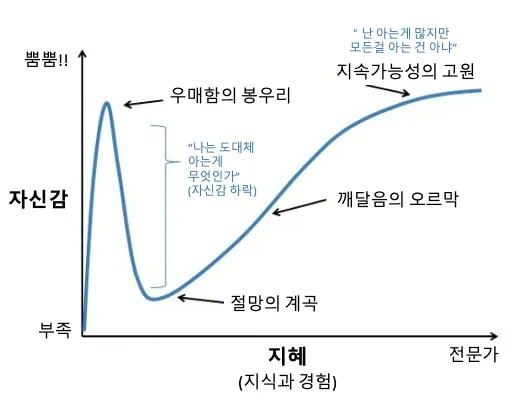

*Gemini4 Argon이 글을 잘쓴다고 해 작성하는데 도움을 받아봤습니다.*

한달정도 전에 산 [yubico 하드웨어키](/blog/yubico/)의 하드웨어 스펙을 전혀 이해 하지 못하고 있기에 ~~(이래도 쓸수 있는 현대 기술 최고)~~ 한번 간단히 정리해 봤습니다.

---

FIDO - Fast IDentity Online
- 인증 시 암호가 아닌 무언가로 진행하는 인증 표준 중 하나
- 각종 생체인식이나 물리 보안키 등이 포함

FIDO U2F - Universal 2nd Factor
- 2차 인증(MFA) 전용 표준
- 비밀번호 인증 후 FIDO 통해 2차인증

FIDO2 / WebAuthn
- Passwordless 인증 가능한 최신 고오급 표준
- PassKey 도 FIDO2 표준 기반
- FIDO2는 아래 두가지 요소로 구성
  - WebAuthn - Web Authentication, 웹 브라우저와 서버가 인증을 주고받을 때 사용하는 웹 표준 API
  - CTAP - Client to Authenticator Protocol, 브라우저나 OS가 외부 인증 기기(유비키 등)와 USB, NFC 등으로 통신할 때 쓰는 프로토콜

Smart Card (PIV - Personal Identity Verification)
- 미정부 표준에서 시작된 스마트카드 규격
- 보안키에 X.509 인증서를 넣어 스마트카드처럼 사용하는 기능
- 주로 엔터프라이즈 환경에서 사용 

OpenPGP
- 이메일, 파일 암호화 및 전자서명용 비대칭키 암호화 표준
- GitHub 커밋 옆에 `Verified` 인증에도 사용
- 개인키를 보안키에 저장할 수 있음

Certifications - FIDO2 L1, FIDO L2
- FIDO에서 보증하는 보안 등급(Security Level)
- L1 - 기본 규격 및 피싱 방지 등 기본 보안 요구사항 충족
- L2 - 별도 하드웨어 보안 환경(보안 칩 등)으로 사용해 소프트웨어 공격 및 기본적인 물리적 키 추출 공격을 방어함을 인증
- L3부터는 군사나 국가기관 등에 사용

---

요즘 느끼는거지만 너무 계곡이 깊은거같아요..

---

참고 문서
- [Yubico - What is FIDO2?](https://www.yubico.com/authentication-standards/fido2/)
- [FIDO Alliance - Security Certification Levels](https://fidoalliance.org/certification/authenticator-certification-levels/)
- [WebAuthn Guide](https://webauthn.guide/)